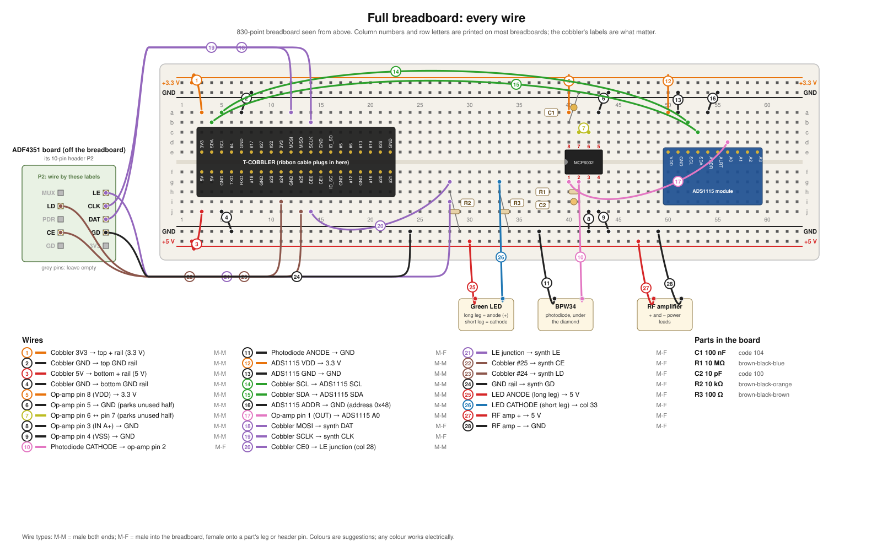
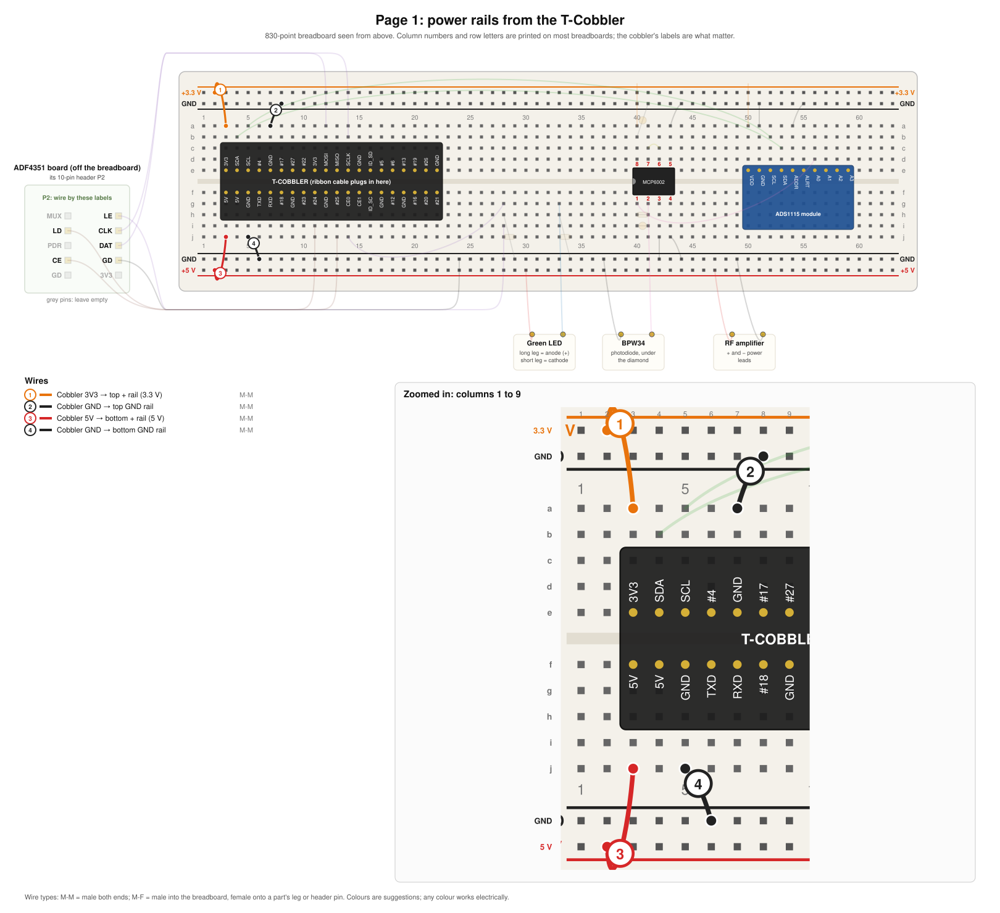
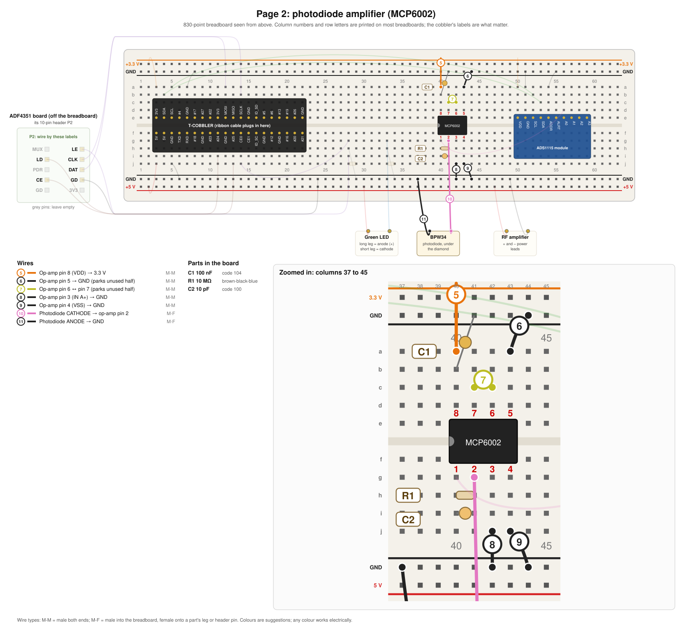
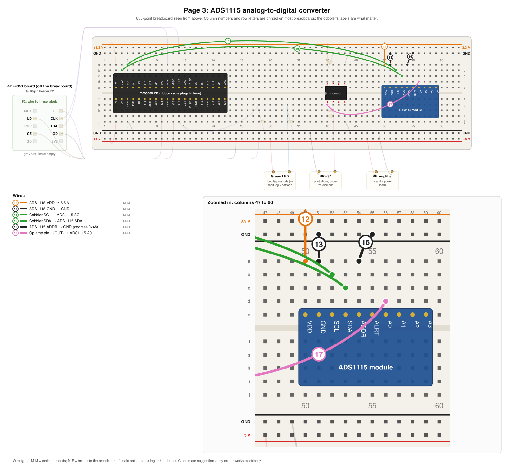
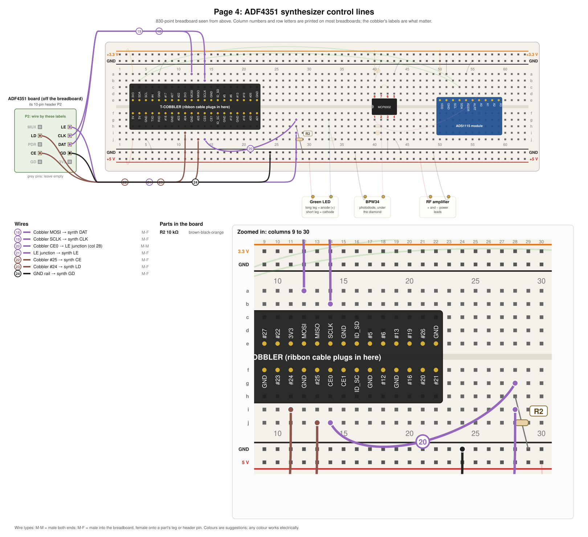
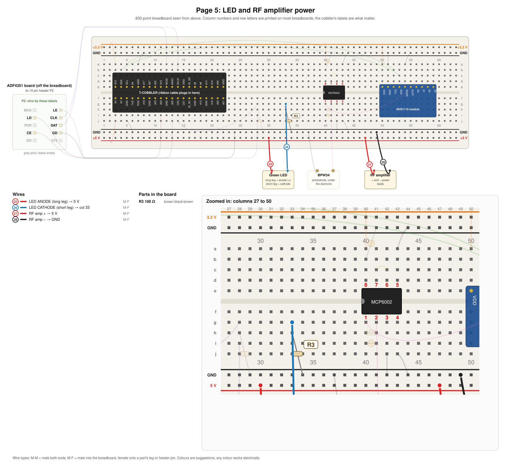

# Breadboard wiring, page by page

Top-down pictures of the 830-point breadboard with everything connected through the T-Cobbler. The Pi isn't shown: it's on the other end of the ribbon cable. Each wire has a number; the table on each page says where it starts and ends, and whether it's a male-male (M-M) or male-female (M-F) jumper.

**Before you start**

* **Unplug the Pi** before adding or moving any wire.
* **Wire by the cobbler's printed labels** (3V3, SDA, MOSI, CE0, #25 …), not by column number. Cobblers from different brands order their labels differently; the pictures use the Adafruit T-Cobbler Plus order.
* **Rails:** top pair = **3.3 V** and GND; bottom pair = **5 V** and GND. Label them with tape. If your breadboard's rails have a break in the middle of the printed line, bridge it with a short wire.
* **Off-board parts** (the ADF4351 board, LED, photodiode and RF amp) are drawn as boxes. Their wires are M-F jumpers: the female end goes onto the part's pin or leg, the male end into the breadboard.

[for_dummies.md](for_dummies.md) has the full explanation and the check to do after each page.

---

## Overview: every wire

## Page 1: power rails

Four wires bring 3.3 V, 5 V and ground from the cobbler to the rails. Check with a multimeter before going on: top + rail ≈ 3.3 V, bottom + rail ≈ 5 V.

## Page 2: photodiode amplifier

The MCP6002 straddles the trench in columns 40 to 43 with its **notch on the left**, which puts **pin 1 bottom left** and **pin 8 top left**. Check this twice: a chip in backwards gets its power reversed.

## Page 3: ADS1115

The module's pins go in row e, columns 50 to 59, with its body hanging over the trench. VDD goes to **3.3 V**, never 5 V.

## Page 4: synthesizer control lines

Pull the three green P3 jumpers on the ADF4351 board first. Column 28 is the **LE junction**: CE0 from the cobbler, the 10 kΩ pull-down to GND, and the wire to the board's LE pin all meet there. Leave P2's 3V3, MUX and PDR empty.

## Page 5: LED and RF amplifier power

Both run from the **5 V** rail. The LED's 100 Ω resistor sits between its cathode column (33) and GND.

---

The pictures are generated by `docs/breadboard/make_diagrams.py`. To move a part, change its column there and run `python3 docs/breadboard/make_diagrams.py`; every page updates.
